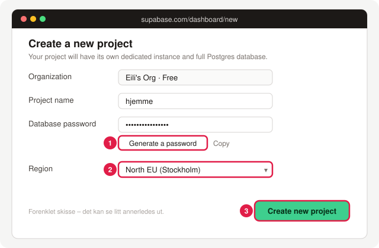
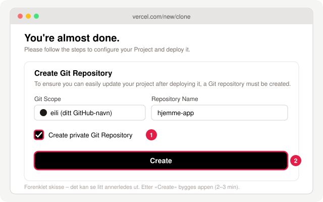
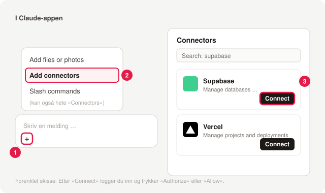
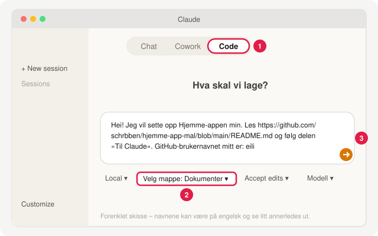
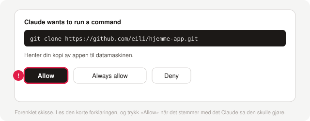
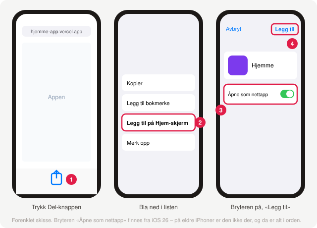
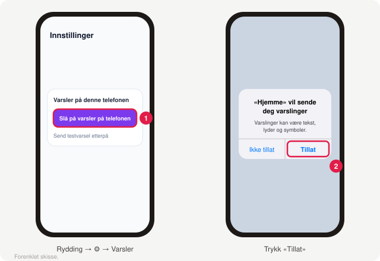

# Hjemme: fryser, bod og rydding

En app til mobilen med tre deler:

- **Fryser:** hva som ligger i fryseren, og hvor lenge det har ligget der.
- **Bod:** boden din i 3D. Trykk på en boks for å se hva som er i den, og legg til eller ta ut ting.
- **Rydding:** faste oppgaver hjemme. Appen foreslår hva som bør gjøres på ryddedagen, og sender et varsel om morgenen.

Dette er en kopi av en app som er i bruk, med eksempeldata i stedet for ekte ting. Du lager din egen kopi, og Claude hjelper deg å tilpasse den, for eksempel til målene på din bod.

> **Slik leser du guiden:** under hvert steg står en kort oppskrift. Trenger du mer hjelp, trykker du på **▸ Mer hjelp**. Der står det mer detaljert hva du skal gjøre, med skisser og hva du gjør hvis noe går galt.
>
> **Står du fast,** kan du alltid spørre Claude. Ta et skjermbilde av det du ser, lim det inn i Claude (Ctrl+V på Windows, Cmd+V på Mac) og spør «hva gjør jeg nå?».

---

## Dette trenger du

| Konto | Hva den brukes til | Pris |
| --- | --- | --- |
| **Claude Pro** | Claude bygger, setter opp og endrer appen for deg | 20 dollar i måneden pluss mva, rundt 250 kr |
| **GitHub** | Lagrer koden til appen | Gratis |
| **Supabase** | Databasen, altså det du legger inn i appen | Gratis |
| **Vercel** | Legger appen ut på nettet, så du kan åpne den på mobilen | Gratis |

**Om Claude Pro:** gratisversjonen av Claude kan ikke bygge og legge ut apper, så du trenger Pro mens du setter opp og endrer appen. Du kan si opp abonnementet når appen er slik du vil ha den. Appen fortsetter å virke, fordi den ligger på dine egne gratiskontoer. Ønsker du endringer senere, kan du ta Pro igjen for en måned.

---

## Steg for steg

Det meste gjør du bare én gang. Regn med rundt halvannen time totalt, og av det er ca. en time sammen med Claude. Gjør stegene i rekkefølge, gjerne på en datamaskin.

| # | Steg | Tid |
| --- | --- | --- |
| 1 | Claude Pro og Claude-appen | 10 min |
| 2 | GitHub-konto | 5 min |
| 3 | Supabase-konto og database | 10 min |
| 4 | Din egen kopi av appen på nettet | 5 min |
| 5 | Koble Claude til Supabase og Vercel | 5 min |
| 6 | La Claude sette opp resten | 30–60 min |
| 7 | Legg appen på mobilen | 5 min |

### 1. Claude Pro og Claude-appen (10 min)
1. Gå til [claude.ai](https://claude.ai), lag en konto og velg **Pro**.
2. Last ned **Claude-appen** til datamaskinen fra [claude.com/download](https://claude.com/download), og logg inn.

<b>▸ Mer hjelp: Claude Pro og appen</b>

**Lag konto og velg Pro**
1. Gå til [claude.ai](https://claude.ai) i nettleseren på datamaskinen.
2. Velg **Continue with Google**, eller skriv inn e-posten din. Bruker du e-post, får du en innloggingslenke eller kode på e-post. Sjekk søppelposten hvis den ikke kommer.
3. Når du er inne, trykker du på navnet ditt nederst til venstre, velger **Upgrade plan** (eller **Settings → Billing**) og så **Pro**.
4. Velg **månedlig** betaling, ikke årlig. Da kan du si opp når appen er ferdig.
5. Betal i nettleseren, ikke i Claude-appen på iPhone. Kjøp via App Store koster mer, og må sies opp i iPhone-innstillingene i stedet.

**Last ned appen til datamaskinen**
1. Gå til [claude.com/download](https://claude.com/download).
2. **Windows:** velg *Download for Windows*, åpne fila og følg veiviseren. Har du en PC med ARM-prosessor, for eksempel en Surface eller en «Copilot+ PC», velg ARM64-versjonen.
3. **Mac:** velg *Download for macOS*, åpne fila og dra Claude inn i *Programmer*.
4. Åpne Claude og logg inn med samme konto som du kjøpte Pro med.
5. Øverst i appen ser du fanene **Chat**, **Cowork** og **Code**. Code-fanen bruker du i steg 6.

**Hvis noe går galt**
- **Code-fanen mangler:** sjekk at du er logget inn med Pro-kontoen. Oppdater appen: lukk den helt og åpne den igjen, eller last den ned på nytt.
- **Windows advarer mot fila** («Windows beskyttet PC-en»): trykk **Mer info → Kjør likevel**, men bare hvis fila kom fra claude.com.
- **Du vil si opp senere:** gå til **Settings → Billing → Cancel**. Du beholder Pro ut perioden du har betalt for.

### 2. GitHub-konto (5 min)
1. Lag en konto på [github.com/signup](https://github.com/signup).
2. Skriv ned brukernavnet ditt. Claude trenger det senere.

<b>▸ Mer hjelp: GitHub</b>

GitHub er der koden til appen lagres. Du trenger ikke forstå koden, men appen må ligge et sted Claude og Vercel kommer til.

1. Gå til [github.com/signup](https://github.com/signup).
2. Velg **Continue with Google** (eller Apple), eller fyll inn:
   - **Email:** e-postadressen din.
   - **Password:** minst 15 tegn, eller minst 8 tegn med både tall og små bokstaver.
   - **Username:** bare bokstaver, tall og bindestrek, for eksempel `eili-hansen`. Dette er brukernavnet Claude spør om.
3. GitHub kan be deg løse en liten **bildeoppgave** for å vise at du ikke er en robot. Det er normalt.
4. Du får en **kode på e-post**, kalt «launch code». Skriv den inn. Sjekk søppelposten hvis den ikke kommer.
5. Får du spørsmål om team, interesser eller plan: velg **Free**, eller hopp over med **Skip**.

Du finner brukernavnet ditt ved å trykke på profilbildet øverst til høyre på github.com. Det står øverst i menyen.

**Hvis noe går galt**
- **«This email can't be used» eller «We couldn't create your account»:** prøv en annen nettleser, eller slå av utvidelser som annonseblokkering. Vent litt og prøv igjen. Fortsatt ikke? Bruk en annen e-postadresse.
- **Koden kommer ikke:** sjekk søppelpost og kampanjer. Be om ny kode etter et par minutter.
- **Brukernavnet er tatt:** legg til noe, for eksempel tall eller etternavn.
- **GitHub ber om totrinnsinnlogging (2FA)** etter en stund: følg instruksjonene. Enklest er en passnøkkel eller GitHub Mobile-appen. Ta vare på gjenopprettingskodene.

### 3. Supabase-konto og database (10 min)
1. Gå til [supabase.com](https://supabase.com), trykk **Start your project** og velg **Continue with GitHub**.
2. Trykk **New project**, og fyll inn:
   - **Name:** `hjemme`
   - **Database Password:** trykk **Generate a password**, og ta vare på passordet, for eksempel i passordappen din.
   - **Region:** *North EU (Stockholm)*
3. Trykk **Create new project**, og vent et par minutter til prosjektet er klart.

<b>▸ Mer hjelp: Supabase</b>

Supabase er databasen, altså stedet der alt du legger inn i appen blir lagret.

**Lag konto**
1. Gå til [supabase.com/dashboard/sign-up](https://supabase.com/dashboard/sign-up).
2. Trykk **Continue with GitHub**, og så **Authorize supabase** på GitHub-siden som dukker opp.

**Lag en organisasjon** (bare første gang)

Supabase spør om en «organization»:
- **Name:** for eksempel navnet ditt.
- **Type:** *Personal*.
- **Plan:** *Free – $0/month*.

Trykk **Create organization**.

**Lag prosjektet**

1. Trykk **New project**.
2. **Project name:** `hjemme`.
3. **Database Password:** trykk **Generate a password** ①. Trykk **Copy**, og lagre passordet i passordappen din eller i et notat. Claude trenger det ikke, men det er greit å ha.
4. **Region:** velg **North EU (Stockholm)** ②. Den ligger nærmest Norge, så appen blir raskest.
5. Andre valg, for eksempel «Security options», lar du stå som de er.
6. Trykk **Create new project** ③. Det tar 1–2 minutter før prosjektet er klart.

**Hvis noe går galt**
- **Du blir bedt om kortnummer:** du har valgt en betalt plan. Gå tilbake og velg **Free**.
- **«You have reached the maximum number of free projects»:** gratisplanen tillater 2 aktive prosjekter. Pause eller slett et gammelt prosjekt, eller bruk det du har, og si fra til Claude.
- **Du finner ikke Stockholm:** velg en annen region i Europa, for eksempel *Central EU (Frankfurt)* eller *West EU*.
- **Senere får du e-post om at prosjektet blir pauset:** gratisprosjekter pauses etter en uke uten bruk. Appen har en daglig jobb som hindrer det, men skjer det likevel, åpner du prosjektet på supabase.com og trykker **Restore project**.

### 4. Din egen kopi av appen på nettet (5 min)
1. Trykk på knappen under:

   

2. Velg **Continue with GitHub**. Da lages Vercel-kontoen din. Velg gratisplanen **Hobby** hvis du blir spurt.
3. Behold navnet `hjemme-app`, huk av **Create private repository**, og trykk **Create**.
4. Vent 2–3 minutter. Nå har du din egen kopi av koden på GitHub, og appen ligger på nettet med en adresse som `hjemme-app-….vercel.app`.

Appen viser feilmeldinger helt til databasen er koblet til i steg 6. Det er helt normalt.

<b>▸ Mer hjelp: Vercel og din egen kopi</b>

Knappen gjør to ting på én gang. Den lager en kopi av koden på din GitHub, og den legger appen ut på nettet med din nye Vercel-konto. Du trenger aldri logge inn på noen andres konto.

**Logg inn eller lag konto**
1. Trykk **Deploy**-knappen over. Du kommer til en side der det står **«Sign in to clone and deploy»**.
2. Velg **Continue with GitHub**. Velg GitHub, ikke Google, ellers kan ikke Vercel lage kopien på GitHub-kontoen din.
3. På GitHub-siden trykker du **Authorize Vercel**.
4. Er du ny hos Vercel, får du kanskje noen spørsmål:
   - **Plan type:** velg **Hobby**, altså personlige prosjekter, som er gratis.
   - **Name:** navnet ditt.
   - Trykk **Continue**.
5. Får du spørsmål om informasjonskapsler (cookies), kan du velge **Deny**.

**Lag kopien**

1. Under **Create Git Repository** skal **Git Scope** være GitHub-brukernavnet ditt.
2. **Repository Name:** behold `hjemme-app`.
3. Huk av **Create private Git Repository** ①, så bare du ser koden.
4. Trykk **Create** ②.
5. Ber Vercel om tilgang til GitHub («Install Vercel» eller «Install GitHub App»), trykker du **Install**. Du kan velge **All repositories**, eller **Only select repositories** og så `hjemme-app`.
6. Nå bygges appen. Det tar 2–3 minutter. Når den er ferdig, ser du konfetti og et lite bilde av appen. Trykk **Continue to Dashboard**.
7. Adressen til appen står under **Domains**, for eksempel `hjemme-app-eili.vercel.app`. Skriv den ned.

**Hvis noe går galt**
- **«Repository name already exists»** (eller at navnet er tatt): skriv et annet navn, for eksempel `hjemme-app-2`. Si fra til Claude hvilket navn du brukte.
- **Du ser ikke «Create Git Repository»,** men bare en knapp for å importere: du er logget inn med Google eller e-post. Gå til **Vercel → Account Settings → Authentication**, og koble til GitHub under **Login Connections**. Trykk så Deploy-knappen på nytt.
- **Bygget feiler** (rødt «Error»): det skal ikke skje. Gå videre til steg 5 og 6 og si fra til Claude. Med Vercel-koblingen kan den lese feilmeldingen selv.
- **Appen viser feilmeldinger** som «Kunne ikke laste» eller «Fikk ikke hentet»: helt normalt nå. Databasen kobles til i steg 6.

### 5. Koble Claude til Supabase og Vercel (5 min)
1. Åpne Claude-appen, trykk **+** ved siden av meldingsfeltet og velg **Add connectors**.
2. Finn **Supabase**, trykk **Connect** og logg inn.
3. Gjør det samme for **Vercel**.

Da kan Claude sette opp databasen og innstillingene for deg, så du slipper å kopiere nøkler.

<b>▸ Mer hjelp: koblinger (connectors)</b>

En kobling gir Claude lov til å jobbe i Supabase og Vercel for deg. Du godkjenner selv hva den får tilgang til, og du kan koble fra når du vil.

1. Åpne Claude-appen. Du kan være i hvilken som helst fane.
2. Trykk **+** ved siden av meldingsfeltet ①, og velg **Add connectors** ②. Står det **Connectors**, velg det og så **Browse connectors**.
3. Søk etter **Supabase**, og trykk **Connect** ③.
4. Et innloggingsvindu åpnes. Logg inn med GitHub, slik du gjorde i steg 3. Velg organisasjonen din hvis du blir spurt, og trykk **Authorize** eller **Allow**.
5. Gjør det samme for **Vercel**.

**Snarveier:** du kan også åpne koblingene direkte:
- [Supabase-koblingen](https://claude.ai/directory/11ca66fc-1e98-49d5-ab9b-7cb4672a8f10)
- [Vercel-koblingen](https://claude.ai/directory/7eb42afe-0087-4493-a105-da2b021d5c03)

**Se eller fjerne koblinger:** trykk **Customize** i sidemenyen og velg **Connectors**.

**Hvis noe går galt**
- **Du finner ikke «Add connectors»:** trykk **Customize** i sidemenyen og så **Connectors**, eller bruk snarveiene over. Sjekk at appen er oppdatert.
- **En kobling står som «Disconnected»:** trykk **Connect** igjen og logg inn på nytt.
- **Claude sier at Vercel mangler tilgang til et «team»:** da lager Claude en godkjenningslenke. Åpne den og trykk **Approve**. Lenken virker bare i 10 minutter, så be Claude om en ny hvis du ikke rakk det.

### 6. La Claude sette opp resten (30–60 min)
1. I Claude-appen velger du fanen **Code**, og så en mappe på datamaskinen, for eksempel *Dokumenter*.
2. Lim inn denne meldingen, og fyll inn GitHub-brukernavnet ditt:

   > Hei! Jeg vil sette opp Hjemme-appen min. Les https://github.com/schrbben/hjemme-app-mal/blob/main/README.md og følg delen «Til Claude». GitHub-brukernavnet mitt er: ______

3. Claude gjør jobben og ber deg om hjelp underveis. Den kan for eksempel be deg logge inn på GitHub i nettleseren, lime inn en nøkkel i Vercel eller svare på spørsmål om boden din.

<b>▸ Mer hjelp: arbeidet med Claude</b>

**Start økten**

1. Trykk på fanen **Code** øverst ①.
2. Under meldingsfeltet er det en rad med valg:
   - **Miljø** (for eksempel «Local»): skal være din datamaskin.
   - **Mappe** ②: trykk og velg for eksempel *Dokumenter*. Claude lager en undermappe til appen der.
   - **Tillatelser:** **Accept edits** passer fint. Da lager og endrer Claude filer selv, men spør før den kjører andre ting.
3. Lim inn meldingen fra punkt 2 over med Ctrl+V (Cmd+V på Mac). Fyll inn GitHub-brukernavnet ditt, og trykk send ③.

**Når Claude spør om lov**

Claude spør før den kjører kommandoer eller installerer noe. Les den korte forklaringen. Stemmer det med det Claude sa den skulle gjøre, trykker du **Allow**. Er du usikker, skriv «hva gjør den kommandoen?» i stedet. Claude forklarer gjerne.

**Ting Claude vil be deg om underveis**
- **Installere Git** hvis du ikke har det. Git er verktøyet som henter og lagrer koden.
  - **Windows:** Claude foreslår en kommando, eller du laster ned fra [git-scm.com](https://git-scm.com/download/win) og trykker **Next** gjennom hele veiviseren.
  - **Mac:** det kan dukke opp et vindu om «Command line developer tools». Trykk **Installer**. Det tar 5–10 minutter.
- **Logge inn på GitHub i nettleseren.** Det dukker opp et vindu eller en nettside der du trykker **Sign in with your browser** og så **Authorize**. Noen ganger får du en kode på 8 tegn som du limer inn på [github.com/login/device](https://github.com/login/device).
- **Lime inn en hemmelig nøkkel i Vercel** (til varslene). Claude legger nøkkelen på utklippstavla uten å vise den. Du gjør slik:
  1. Gå til [vercel.com](https://vercel.com) og åpne prosjektet `hjemme-app`.
  2. Gå til **Settings → Environment Variables**, og trykk **Add Environment Variable**.
  3. **Key:** `VAPID_PRIVATE_KEY`. **Value:** lim inn med Ctrl+V (Cmd+V).
  4. Slå på **Sensitive** og velg **Production** og **Preview**. Trykk **Save**.
  5. Det blir to rader med samme navn, én per miljø. Det er riktig.
- **Svare på spørsmål** om boden, fryseren og ryddeoppgavene. Ta gjerne bilder av boden og boksene, og dra dem inn i Claude.

**Hvis noe går galt**
- **«Git is required»** (Windows): installer Git fra [git-scm.com](https://git-scm.com/download/win), og start Claude-appen på nytt. Hjelper ikke det, oppdater Claude-appen.
- **Claude stopper med en melding om at grensen er nådd:** Pro har en bruksgrense som fylles opp igjen etter noen timer. Kom tilbake senere og skriv «fortsett» i samme økt. Du finner økten i sidemenyen.
- **Du lukket appen midt i:** åpne Claude, gå til **Code**, velg økten i sidemenyen og skriv «fortsett der vi slapp».
- **Du forstår ikke hva Claude spør om:** skriv «forklar enklere», eller ta et skjermbilde og lim det inn.
- **Vercel sier at en utrulling er «blocked»,** for eksempel «commit author …»: si fra til Claude. Den må lagre endringene med din GitHub-e-post som forfatter.

### 7. Legg appen på mobilen (5 min)
1. Åpne adressen til appen i **Safari** på iPhone, eller Chrome på Android.
2. Trykk **Del → Legg til på Hjem-skjerm**. Nå ligger appen på mobilen som en vanlig app.
3. Åpne den fra ikonet, gå til **Rydding → ⚙️** og trykk **Slå på varsler**. Varsler virker bare når appen åpnes fra ikonet på hjemskjermen.

Vil flere bruke appen, sender du dem adressen, og de gjør steg 7.

<b>▸ Mer hjelp: appen på mobilen og varsler</b>

**iPhone**

1. Åpne **Safari** og skriv inn adressen til appen, for eksempel `hjemme-app-eili.vercel.app`.
2. Trykk **Del-knappen**, firkanten med pil opp, nederst eller øverst på skjermen ①.
3. Bla ned i listen, og trykk **Legg til på Hjem-skjerm** ②.
4. Har iPhonen iOS 26 eller nyere, er det en bryter som heter **Åpne som nettapp** ③. Den må være **på**. På eldre iPhoner finnes ikke bryteren, og da er alt i orden.
5. Trykk **Legg til** ④. Appen ligger nå på hjemskjermen.

**Slå på varsler**

1. Åpne appen **fra ikonet på hjemskjermen**, ikke fra Safari.
2. Gå til **Rydding**, trykk **⚙️** og så **Slå på varsler på denne telefonen** ①.
3. iPhone spør om appen kan sende varslinger. Trykk **Tillat** ②.
4. Trykk **Send testvarsel**. Det skal komme et varsel i løpet av noen sekunder.
5. Gjør det samme på andres telefoner som skal ha varsel.

**Android:** åpne appen i Chrome, trykk **⋮** og så **Legg til på startsiden** eller **Installer app**. Varsler slår du på på samme måte, i Rydding → ⚙️.

**Hvis noe går galt**
- **Appen åpnes med Safaris adressefelt øverst:** den er lagret som et vanlig bokmerke. Hold fingeren på ikonet, velg **Fjern bokmerke**, og legg den til på nytt fra Safari. På iOS 26: sjekk at **Åpne som nettapp** er på.
- **Det står at appen må ligge på Hjem-skjermen,** selv om du åpnet den derfra: se punktet over.
- **Du finner ikke «Legg til på Hjem-skjerm»:** bla helt ned i Del-menyen. Finnes den ikke der heller, trykk **Rediger handlinger** nederst og legg den til.
- **iPhone spør ikke om varsler,** eller det står «Varsler er blokkert»:
  - Gå til **Innstillinger → Varslinger → Hjemme** og slå på **Tillat varslinger**.
  - Står ikke appen i listen? Åpne appen fra ikonet og trykk knappen én gang til.
- **Krav til iOS:** varsler krever iOS 16.4 eller nyere. Sjekk under **Innstillinger → Generelt → Om → iOS-versjon**.
- **Testvarselet kommer ikke:** sjekk at **Fokus** eller **Ikke forstyrr** er av. Prøv deretter **Slå av** og **Slå på varsler** igjen i appen.

---

## Til Claude

*Denne delen er til Claude. Eili trenger ikke lese den.*

Du hjelper Eili å sette opp og tilpasse sin egen kopi av denne appen. Regn med at hun ikke er teknisk.

- Snakk norsk bokmål og enkelt, og ta ett steg om gangen.
- Når hun må gjøre noe selv, si nøyaktig hva hun skal trykke på, og hvorfor.
- Spør før du installerer noe på maskinen hennes.
- Be gjerne om skjermbilder når noe er uklart.
- Hvis tidsestimatene i stegene over ikke stemmer for henne, si fra underveis.
- I repoet hennes ligger **CLAUDE.md** med arkitektur, regler og fallgruver. Les den før du endrer kode.
- Sjekk først hvilke av steg 1–5 hun har gjort, og hjelp henne med det som mangler. «Mer hjelp» under hvert steg beskriver detaljene og vanlige feil.

### A. Oppsett, i denne rekkefølgen

1. **Koden.** Vercel-knappen i steg 4 laget et privat repo på GitHub-kontoen hennes, sannsynligvis `<brukernavn>/hjemme-app`. Klon det til mappen hun valgte.
   - Mangler Git, spør først og installer det: `winget install Git.Git` på Windows, `xcode-select --install` på Mac.
   - For å kunne pushe må hun logge inn på GitHub i nettleseren. På Windows skjer det av seg selv ved første push (Git Credential Manager). Ellers bruker du `gh auth login --web`. Forklar henne at hun bare skal godkjenne i nettleseren.
   - Har hun ikke gjort steg 4, kan du klone https://github.com/schrbben/hjemme-app-mal og pushe til et nytt privat repo på hennes konto. Det krever ingen innlogging hos eieren av malen.
   - **Viktig for Vercel Hobby:** utrullinger blir blokkert hvis forfatteren av commiten ikke er eieren av Vercel-kontoen. Sett derfor `git config user.name` og `git config user.email` i repoet til hennes GitHub-identitet før første commit.
     - Bruk en bekreftet e-post på GitHub-kontoen hennes, eller hennes `ID+brukernavn@users.noreply.github.com`.
     - Du finner den med `gh api user/emails` eller ved å spørre henne.
2. **Databasen.** Finn Supabase-prosjektet hennes med Supabase-koblingen, og kjør `supabase/oppsett.sql`, for eksempel med `apply_migration`.
   - Hent prosjektadressen (`get_project_url`) og nøkkelen (`get_publishable_keys`).
   - **Bruk den nye publishable-nøkkelen** (`sb_publishable_…`). Den gamle anon-nøkkelen (`eyJ…`) fases ut ved slutten av 2026. Koden (supabase-js 2.95) virker med begge, og sanntid er testet med den nye.
3. **Vercel.** Med Vercel-koblingen legger du inn `NEXT_PUBLIC_SUPABASE_URL` og `NEXT_PUBLIC_SUPABASE_PUBLISHABLE_KEY` for alle miljøer.
   - Godkjenning: hvis koblingen mangler tilgang til teamet hennes, lag en godkjenningslenke med `authorize_team_access`. Den går ut etter 10 minutter, så lag en ny ved behov.
4. **Varselnøkler.** Lag VAPID-nøkler med `npx web-push generate-vapid-keys` direkte inn i `.env.local`, uten å skrive dem ut.
   - Legg `NEXT_PUBLIC_VAPID_PUBLIC_KEY` inn i Vercel selv.
   - Den private nøkkelen (`VAPID_PRIVATE_KEY`) skal ikke innom deg. Legg den på utklippstavla hennes uten å vise den: `Set-Clipboard` i PowerShell på Windows, `pbcopy` på Mac.
   - La henne lime den inn i Vercel slik «Mer hjelp» i steg 6 beskriver. Tøm utklippstavla etterpå.
5. **Legg ut på nytt.** Push en commit, så Vercel bygger med de nye variablene. Sjekk at utrullingen blir `READY` (`list_deployments`).
6. **Morgenvarselet.** Bytt ut `DIN-APP.vercel.app` i `supabase/varsel.sql` med adressen hennes, og kjør fila. Den skrur på pg_net og pg_cron i Supabase, som vekker `/api/rydding/varsel` hvert kvarter.
7. **Sjekk at alt virker:**
   - Åpne `/`, `/bod` og `/rydding`.
   - Kall `https://<adresse>/api/rydding/varsel?dryRun` fra Supabase med `net.http_get`, og les svaret i `net._http_response`. Bruk ikke curl, fordi Vercel ofte blokkerer gjentatte kall derfra.
   - Hjelp henne med steg 7 og et testvarsel under Rydding → ⚙️.

### B. Spør hva hun ønsker

Når appen virker, still disse spørsmålene, gjerne noen få om gangen:

- **Delene:** vil hun ha alle tre? Det hun ikke trenger, kan fjernes fra appvelgeren (`components/AppSwitcher.tsx`) og rutene.
- **Boden:** dette er det viktigste å få riktig.
  - Hvor mange boder har hun, og hvilke mål har de: lengde, bredde, høyde, hvor døra er, og om det er skråtak?
  - Hvilke hyller har hun: merke eller mål, antall hyllenivåer, hvor mange bokser per nivå, og hvor i rommet de står?
  - Hvilke bokstyper har hun? Be om bilder.
  - Har boksene nummer? Hvis ikke: foreslå å nummerere dem med lapper.
  - Romgeometrien ligger i `ROOMS` i `lib/storage.ts`, og hylleplasseringen i `SHELF_LAYOUT` i `components/bod/StorageScene.tsx`. Originalen er en kjellerbod på 2 × 3 m med to Biltema-hyller og en loftsbod med skråtak.
- **Innholdet i boksene:** har hun lister, notater eller bilder? Det raskeste er at hun tar bilder av innholdet, eller lister det opp. Så legger du det inn i databasen for henne, i stedet for at hun taster alt i appen.
- **Fryseren:** hvem deler den?
- **Rydding:**
  - Hvilken dag er ryddedag, og hvor mye tid har hun i uka?
  - Gå gjennom de 48 startoppgavene sammen med henne. Hva passer, hva skal bort, og hvilke intervaller og tider stemmer?
  - Når gjorde hun ting sist? Det kan hun legge inn under ⚙️ → *Legg inn sist gjort*.
- **Hvem skal bruke appen**, og på hvilke telefoner? På iPhone må appen ligge på Hjem-skjermen for å få varsler.
- **Personvern:** appen har ingen innlogging, så alle med lenken kan se og endre. Forklar dette. Vil hun ha innlogging, kan det bygges senere.

### C. Gode vaner videre

- **Små steg:** gjør én endring om gangen. Test den lokalt med `npm run dev` og demodata (`/bod?demo`, `/rydding?demo`), og vis henne resultatet før du pusher. En push til `main` legges ut automatisk.
- **Databaseendringer:** lagre hver endring som en ny nummerert fil i `supabase/`, kjør den med Supabase-koblingen, og sjekk resultatet.
- **Gratisplanene:**
  - Supabase setter prosjekter på pause etter 7 dager uten bruk. `vercel.json` har en daglig jobb (`/api/keepalive`) som hindrer det, og varseljobben holder databasen i gang i tillegg.
  - Vercel Hobby er for privat bruk.
- **Når appen er ferdig**, kan hun si opp Claude Pro. Fortell henne det.
